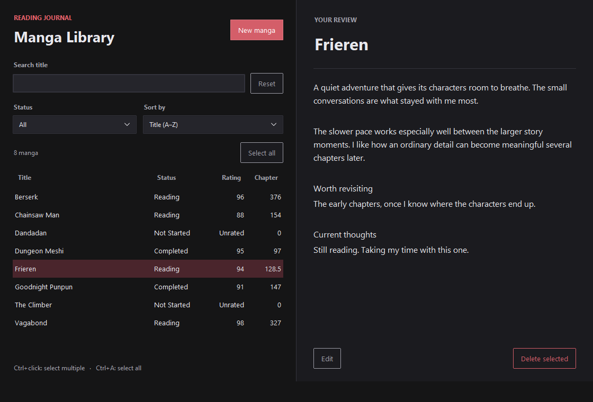
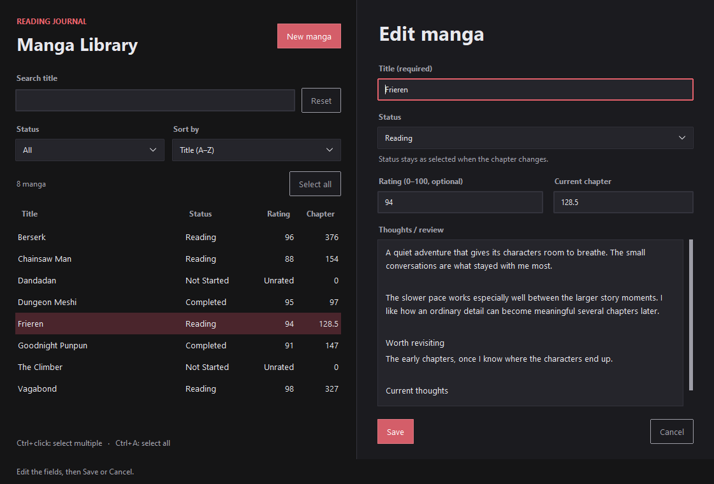

# Personal Manga Reading Journal

A local desktop manga journal built with Python, Tkinter (styled with ttkbootstrap), and SQLite. The
current version lets you add manga, read saved reviews, edit entries,
delete selected entries, search titles, filter by status, and sort by rating. Your
library persists across application restarts.

### Library and review



### Add or edit manga



## Setup 

All commands and relative paths in this README assume your current directory
is the project root, `personal-manga-reading-journal/`. Use a Unix-based terminal to run the commands below.

To build Python version must be at least 3.10, as required by ttkbootstrap and the project's type
annotations.

```bash
python -m venv .venv
source .venv/Scripts/activate # Windows
python -m pip install -r requirements/requirements.txt
```

## Run the application

With the virtual environment active, run:

```bash
python main.py
```

### Library actions

A window titled **Manga Library** opens with the saved-manga list on the left
and the selected manga's title and review on the right. The first manga is
selected when a saved library opens. All actions stay in the same window:

- Click a manga to read its review. Entries without a review show "No review yet."
- Click **New manga** for an empty form, then **Save** to add it.
- Click **Edit** to load the selected manga's existing fields into the form.
  **Save** updates that entry; **Cancel** returns to the review without saving.
- Click **Delete selected**, then confirm, to remove the selected manga and
  their reviews. Multiple selected manga are deleted in one transaction;
  failure rolls back the entire batch.

Use **Ctrl+click** to add or remove individual rows from the selection, or
**Shift+click** to select a range. **Select all** selects every displayed row.
**Ctrl+A** does the same when the manga list has keyboard focus; the shortcut
is bound to the list shown rather than all entries.

Selecting one manga shows its review and enables Edit. Selecting multiple
manga shows their selection count on the right and disables Edit. Delete
selected asks for confirmation once, including the number of manga when more
than one is selected. It acts only on selected IDs; duplicate titles remain
separate entries. To clear the entire library, use **Reset**, then **Select
all** (or Ctrl+A in the list), then **Delete selected** and confirm.

New and Edit temporarily replace the review panel with the form. Save returns
to the review panel. Switching manga, starting another form, changing the list
controls, or closing the window asks before discarding a changed draft. Cancel
explicitly discards the current draft. Edit and Delete are disabled when no
manga is selected.

The controls above the list work together:

- **Search title:** updates as you type and matches any part of a title,
  ignoring case, including Unicode case differences. Surrounding search
  whitespace is ignored; characters such as percent and underscore are literal.
- **Status:** choose All, Not Started, Reading, Completed, or Dropped.
- **Sort by:** defaults to Title (A–Z), with Rating: low to high and Rating:
  high to low also available. Unrated entries stay last in both rating orders;
  equal ratings are ordered alphabetically by title. A rating of 0 is rated.
- **Reset:** clears the search, selects All statuses, restores title order, and
  selects the first manga, even if the controls were already at their defaults.

Ordinary search, status, and sort changes keep selected manga that still
match. Hidden rows are removed from the selection. If none of the selected
rows match, the first matching entry is selected. Reset always starts with
only the first manga selected. No matches shows a message and disables Edit,
Delete selected, and Select all; Reset returns to the whole library. The count shows matching entries
while search or status filtering is active. These controls affect the view,
not the saved data, and start at their defaults when the app is reopened.

Titles are trimmed and cannot be blank. Other fields are optional when adding:

- **Status:** Automatic saves Not Started at chapter 0, or Reading above 0.
  An explicit selection always takes priority. Editing starts with the saved
  status; changing the chapter does not change that status automatically.
- **Rating:** a whole number from 0 to 100. Leaving it blank means Unrated;
  a rating of 0 is a valid score.
- **Current chapter:** a finite, nonnegative number, including decimals such
  as 10.5. Leaving it blank means 0.
- **Thoughts / review:** optional free-form text saved with the entry.

After adding or editing, the saved entry stays selected if it matches the
current search and status. Otherwise, a message explains that it was saved
but is hidden by the current filters. Use Reset to find it. Database IDs
identify entries, so editing a title does not create a duplicate and entries
with the same title remain separate.

## Local storage

On Windows, the app creates and reuses:

```text
%LOCALAPPDATA%/MangaLibrary/library.sqlite3
```

This is usually under `C:/Users/<username>/AppData/Local/`. The location is
resolved in `default_database_path()` in `manga_journal/database.py`, so the
app does not hardcode a drive letter. Data stays separate from the executable
and source code. Rebuilding or moving the executable does not move the library.

The single `manga` table contains `id`, `title`, `status`, `rating`,
`current_chapter`, and `review`. SQL constraints back up input validation, and
parameterized queries keep user text separate from SQL instructions.
Search and sorting happen in the library layer for this small local collection;
search uses Python's Unicode-aware case folding.

## Build a Windows executable

From the project root, use the virtual environment's Python explicitly so
PyInstaller can include the installed runtime dependencies. These commands
work in Git Bash even if the environment has not been activated:

```bash
./.venv/Scripts/python.exe -m PyInstaller --clean --onedir --name MangaLibrary --specpath build main.py
./dist/MangaLibrary/MangaLibrary.exe
```

This initial build keeps a console available for debugging. Distribute the
entire `dist/MangaLibrary/` folder, including its supporting files (make a dir for debugging ease). Generated
build files and the packaging specification go under `build/`; the finished
application goes under `dist/`. On a repeat folder build, PyInstaller may ask
to replace the previous output. Add `--noconfirm` to skip that prompt.

For a single executable with no console window:

```bash
./.venv/Scripts/python.exe -m PyInstaller --clean --onefile --windowed --name MangaLibrary --specpath build main.py
./dist/MangaLibrary.exe
```
  
The packaged application includes its Python runtime and required dependencies.

## Code layout

```text
main.py                       # Entry point: starts the app's event loop
manga_journal/
    __init__.py               # Marks the directory as a Python package
    ui.py                     # Library list, review panel, and add/edit form
    theme.py                  # Dark palette, fonts, widget styles, and scrollbars
    library.py                # Validation, title/status filtering, and sorting
    database.py               # Resolves storage location and runs SQLite queries
requirements/
    requirements.txt          # Third-party dependency list
tests/
    __init__.py
    test_library.py            # Storage, validation, filtering, and atomic bulk deletion
    test_ui.py                 # Forms, multiple selection, draft protection, and controls
```